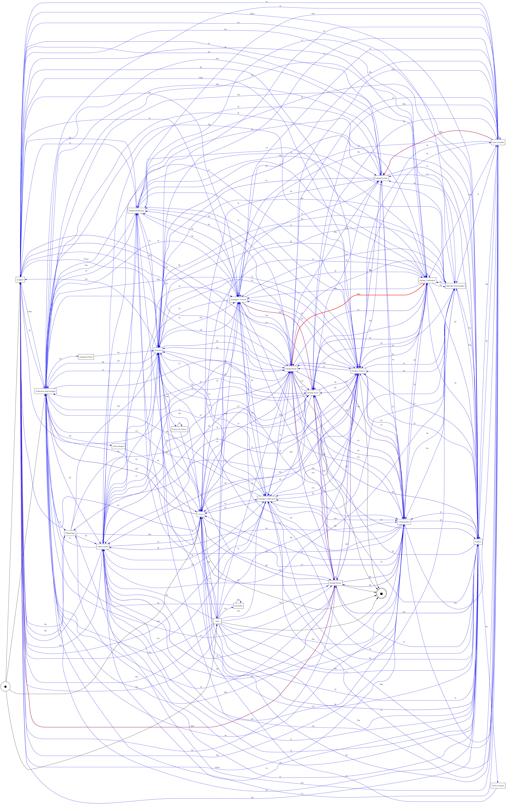
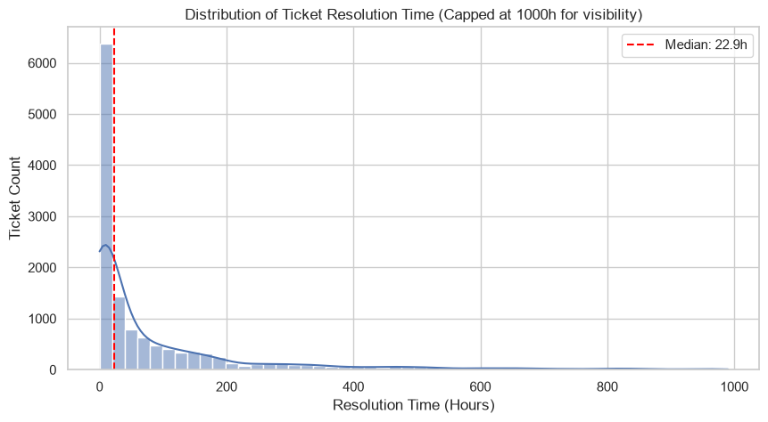

<div align="center">
  <h1>🔍 FlowLens: IT Incident Process Mining</h1>
  <p><i>Uncovering hidden bottlenecks and operational inefficiencies in IT Service Management.</i></p>
  
  
  
  
</div>

<br>

## 📌 Project Overview
In large organizations, IT tickets often get stuck in endless loops of reassignments, costing time and money. **FlowLens** is a Data Analytics project that uses **Process Mining (PM4Py)** to analyze **114,807 real-world IT incidents** and visualize exactly where the workflow breaks down.

Instead of just looking at standard metrics, this project reconstructs the *actual* paths tickets take, exposing SLA breaches and hidden operational bottlenecks.

---

## 🎯 Business Value & Key Insights
By applying process mining techniques, this project uncovered three major operational insights:

1. **The "Ping-Pong" Effect:** A significant volume of tickets bounce back and forth between teams (`reassigned-misrouted`). We visualized this inefficiency and quantified the exact delay it causes.
2. **SLA Breach Tracking:** Analyzed the **Mean Time to Resolution (MTTR)** and identified the specific pathways that caused tickets to breach the standard 72-hour Service Level Agreement.
3. **Bottleneck Discovery:** Generated Directed Follows Graphs (DFG) to map the flow of tickets. This visually highlights the specific states (e.g., *Pending Vendor*) that act as massive roadblocks in the resolution pipeline.

---

## 📊 Visualizing the Data

### 1. Operational Dashboard
We built an interactive **Streamlit Dashboard** that allows stakeholders to filter tickets by reassignment counts and instantly view the resulting SLA impact.
*(Run `streamlit run dashboard/app.py` to view)*

### 2. Process Flow Bottlenecks
Using PM4Py, we generated a **Performance DFG (Directly Follows Graph)**. The red paths indicate the longest delays between IT statuses.



### 3. Resolution Time Distribution
Analyzing the MTTR reveals a heavy right-skew, showing that while most tickets resolve quickly, a problematic subset gets stuck in the system for weeks.



---

## 🛠️ Repository Structure
```text
📦 flowlens-process-mining
 ┣ 📂 data
 ┃ ┗ 📂 processed          # Cleaned CSV logs and aggregated ticket KPIs
 ┣ 📂 notebooks
 ┃ ┣ 📜 01_data_cleaning_and_kpis.ipynb    # Data cleaning & SLA analysis
 ┃ ┗ 📜 02_process_discovery.ipynb         # PM4Py bottleneck mappings
 ┣ 📂 src
 ┃ ┣ 📜 data_preprocessing.py              # Automated data cleaning pipeline
 ┃ ┗ 📜 export_figures.py                  # Script to generate visualizations
 ┣ 📂 dashboard
 ┃ ┗ 📜 app.py                             # Interactive Streamlit Web App
 ┣ 📂 figures                              # Exported PNG charts and PM4Py graphs
 ┗ 📜 requirements.txt                     # Project dependencies
```

---

## 🚀 How to Run Locally

**1. Install Dependencies**
```bash
pip install -r requirements.txt
```

**2. Generate the Visualizations (Optional)**
```bash
python src/export_figures.py
```

**3. Launch the Dashboard**
```bash
streamlit run dashboard/app.py
```

---

## 💼 Resume Bullet Points (STAR Format)
If you are reviewing this project for a Data Analyst or Data Science position, here is a summary of the technical achievements:

> - **IT Incident Process Mining:** Engineered a Python-based ETL pipeline processing **114,000+ IT service logs**, calculating critical KPIs like Mean Time to Resolution (MTTR) and SLA breach rates.
> - **Bottleneck Discovery:** Applied **PM4Py** to generate Directly Follows Graphs (DFGs), successfully identifying hidden reassignment loops (*ping-pong effect*) that caused significant multi-day resolution delays.
> - **Interactive Dashboarding:** Developed and deployed a dynamic **Streamlit** dashboard, enabling stakeholders to filter workflow bottlenecks interactively and visualize operational inefficiencies.
